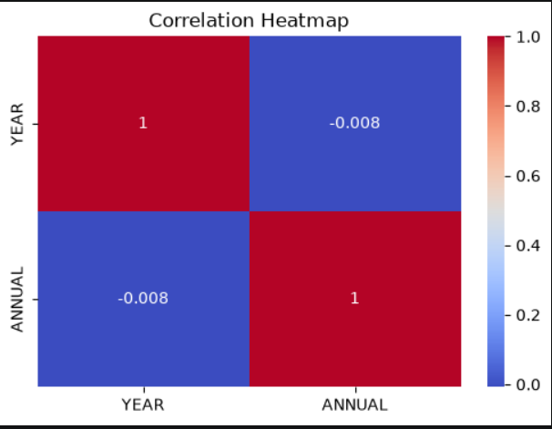
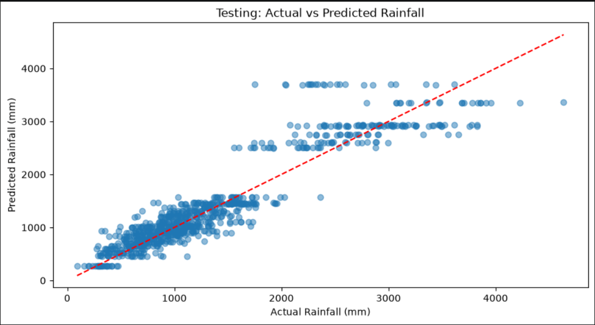
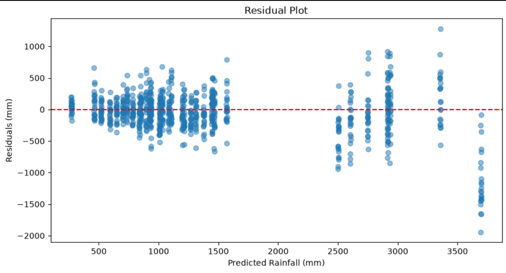

# 🌧️ Rainfall Prediction Using Linear Regression


A machine learning project that predicts annual rainfall for different subdivisions of India using historical rainfall data from 1901 to 2015. The project uses **Linear Regression** with subdivision and year as input features.

**GitHub Repository:** https://github.com/2026eeb1391-sudo/AI-mini-project

---

## 1. Team and Roles

**Team Number: 4**

| Member | Entry Number | GitHub Handle | Role |
|---|---|---|---|
| Parul ||2026eeb1391|| Add GitHub profile | Project development |
| Parvesh kumar ||2026dab1300|| Add GitHub profile | Data preprocessing and EDA |
| Tate Shivraj pramod ||2026aib1087|| Add GitHub profile | Model training and evaluation |


> Replace the placeholders above with the actual names, entry numbers, GitHub profiles, and agreed team roles.

---

## 2. Project Description

### Problem Statement

Rainfall is important for agriculture, water resource management, and planning. Studying historical rainfall records can help us understand rainfall patterns across different parts of India.

In this project, we use historical rainfall data to train a machine learning model that estimates annual rainfall for a selected Indian subdivision and year.

### Objective

- Explore historical rainfall data for India.
- Clean the required data and handle missing values.
- Study the relationship between year and annual rainfall.
- Train a Linear Regression model.
- Compare actual rainfall with model predictions.
- Allow a user to enter a subdivision and year to obtain a rainfall estimate.

### Task Type

**Supervised Machine Learning — Regression**

The target is a continuous numerical value: annual rainfall in millimetres (mm).

### Project Workflow

```text
Load Dataset
     |
     v
Select Required Columns
     |
     v
Clean Missing Values
     |
     v
Exploratory Data Analysis
     |
     v
Chronological Train-Test Split
     |
     v
One-Hot Encode Subdivision
     |
     v
Train Linear Regression Model
     |
     v
Predict Annual Rainfall
     |
     v
Evaluate Model and Display Graphs
     |
     v
Accept User Input for Prediction
```

### Main Steps

1. Read the CSV dataset using Pandas.
2. Select `SUBDIVISION`, `YEAR`, and `ANNUAL`.
3. Remove records with missing values in the selected columns.
4. Explore the cleaned data using descriptive statistics and a correlation heatmap.
5. Use earlier years for training and later years for testing.
6. Convert subdivision names into numerical features using One-Hot Encoding.
7. Train a Linear Regression model through a Scikit-learn Pipeline.
8. Evaluate training and testing predictions.
9. Display comparison and residual graphs.
10. Ask the user for a subdivision and year, then display the predicted annual rainfall.

---

## 3. Dataset

- **Dataset:** Rainfall in India (1901–2015)
- **CSV file:** `rainfall in india 1901-2015.csv`
- **Period covered:** 1901–2015
- **Target column:** `ANNUAL`
- **Input columns:** `SUBDIVISION`, `YEAR`
- **Target unit:** Millimetres (mm)

The dataset file should be kept in the project root folder, alongside the Python script, unless the CSV path in the code is updated.

### Columns Used

| Column | Role | Description |
|---|---|---|
| `SUBDIVISION` | Input | Name of the Indian rainfall subdivision |
| `YEAR` | Input | Year of the observation |
| `ANNUAL` | Target | Total annual rainfall in millimetres |

Only these three columns are selected by the current program.

---

## 4. Technologies and Libraries

| Library / Tool | Purpose |
|---|---|
| Python | Programming language |
| Pandas | Loading, selecting, and cleaning data |
| NumPy | Numerical operations |
| Matplotlib | Creating graphs |
| Seaborn | Creating the correlation heatmap |
| Scikit-learn | Machine learning and evaluation |
| OneHotEncoder | Encoding subdivision names |
| ColumnTransformer | Applying preprocessing to selected columns |
| Pipeline | Combining preprocessing and model training |
| LinearRegression | Predicting annual rainfall |

---

## 5. Project Structure

The files provided for this project are arranged as follows:

```text
AI-mini-project/
│
├── rainfall in india 1901-2015.csv
│       # Historical rainfall dataset
│
├── rainfall_prediction10.py
│       # Data preprocessing, EDA, model training,
│       # evaluation, graphs, and user-input prediction
│
├── README.md
│       # Project documentation
│
└── requirements.txt
        # Python library dependencies (recommended)
```

The `README.md` and `requirements.txt` files can be added to the repository if they are not already present. The current Python script displays its graphs using `plt.show()`; it does not automatically save graph image files.

---

## 6. Data Preprocessing

The program performs the following steps:

1. Selects `SUBDIVISION`, `YEAR`, and `ANNUAL`.
2. Removes rows where `ANNUAL` is missing.
3. Removes rows where `SUBDIVISION` or `YEAR` is missing.
4. Converts `YEAR` into integer format.
5. Checks the remaining missing values.

### Exploratory Data Analysis (EDA)

The program performs:

- Display of the first five dataset rows.
- Dataset shape and information.
- Missing-value count.
- Statistical summary using `describe()`.
- Count of unique subdivisions.
- Correlation between `YEAR` and `ANNUAL`.
- Correlation heatmap using Seaborn.

---

## 7. Model Development

### Linear Regression

Linear Regression is a supervised machine learning algorithm used to estimate a continuous numerical value.

In this project, the model uses the subdivision and year to estimate annual rainfall.

### Input and Target

- **Input features (`X`):** `SUBDIVISION`, `YEAR`
- **Target (`y`):** `ANNUAL`

### One-Hot Encoding

`SUBDIVISION` contains category names rather than numerical values. `OneHotEncoder` converts these categories into numerical indicator columns so the model can use them.

The encoder is configured with `handle_unknown='ignore'` so an unseen category does not cause an encoding error.

### Chronological Train-Test Split

The code sorts the unique years and uses approximately:

- **80% of unique years:** training period
- **Remaining 20% of unique years:** testing period

Earlier years are used for training and later years are used for testing. This is a chronological split, rather than a random row split.

### Scikit-learn Pipeline

A Pipeline combines:
1. The `ColumnTransformer` that one-hot encodes `SUBDIVISION` and passes `YEAR` through.
2. The `LinearRegression` estimator.

---

## 8. Model Evaluation

The model is evaluated on both training and testing data using four regression metrics.

| Metric | Meaning |
|---|---|
| MAE | Mean Absolute Error: average absolute prediction error |
| MSE | Mean Squared Error: average squared prediction error |
| RMSE | Root Mean Squared Error: square root of MSE, in the target's unit |
| R² Score | Measures how much variation in the target is explained by the model |

### Interpretation

- Lower MAE, MSE, and RMSE generally indicate smaller prediction errors.
- An R² value closer to 1 generally indicates a better fit.
- R² can be negative when the model performs worse than predicting the test-set mean.
- The program also prints `R² × 100` as an “accuracy-like” percentage. **This is not classification accuracy**; it is only a rescaled R² score.

Actual metric values should be added to this README only after running the project and recording the output.

---

## 9. Graphs and Visualizations

The current Python script displays the following graphs:

### Graph 1: Correlation Heatmap

Shows the correlation between `YEAR` and `ANNUAL` in the cleaned dataset.

### Graph 2: Training — Actual vs Predicted Rainfall

A scatter plot comparing actual and predicted rainfall for the training data.

### Graph 3: Testing — Actual vs Predicted Rainfall

A scatter plot comparing actual and predicted rainfall for the testing data. A dashed reference line shows where predictions would equal actual values.

### Graph 4: Residual Plot

Shows prediction residuals against predicted rainfall.

**Residual = Actual Rainfall − Predicted Rainfall**

The horizontal zero line represents a residual of zero.

### Graph 5: Actual vs Predicted Comparison

A line graph comparing actual and predicted rainfall for the first 30 test records.

> The current script displays these plots on screen. To include them as images in this README, save the figures from Python and add their image paths here.

---

## 10. Installation and Setup

### Requirements

- Python 3.10 or higher
- pip
- Git
- The rainfall CSV dataset

### Step 1: Clone the Repository

```bash
git clone https://github.com/2026eeb1391-sudo/AI-mini-project.git
```

### Step 2: Open the Project Folder

```bash
cd AI-mini-project
```

### Step 3: Create a Virtual Environment

```bash
python -m venv venv
```

### Step 4: Activate the Virtual Environment

Choose the command for the terminal you are using.

**Windows PowerShell (VS Code default):*

Recommended fix (for your Windows user):

1. In the VS Code PowerShell terminal, run:

   ```powershell
   Set-ExecutionPolicy -Scope CurrentUser -ExecutionPolicy RemoteSigned
   ```

2. If PowerShell asks for confirmation, type `Y` and press Enter.
3. Activate the environment:

   ```powershell
   .\venv\Scripts\Activate.ps1
   ```

If you do not want to change the policy for your user, use this temporary setting for the current terminal session only:

```powershell
Set-ExecutionPolicy -Scope Process -ExecutionPolicy Bypass
.\venv\Scripts\Activate.ps1
```

You can also avoid PowerShell activation by opening a **Command Prompt** terminal in VS Code and running:

```cmd
venv\Scripts\activate.bat
```

When activation works, the terminal prompt starts with `(venv)`, for example:

```text
(venv) PS C:\Users\YourName\AI-mini-project>
```

### Step 5: Install Required Libraries

Create a `requirements.txt` file containing:

```text
pandas
numpy
matplotlib
seaborn
scikit-learn
```

Then run:

```bash
pip install -r requirements.txt
```

---

## 11. How to Run the Project

Run the following command from the main project folder:

```bash
python rainfall_prediction10.py
```

Make sure the CSV file is in the same folder as the Python script and its filename is exactly:

```text
rainfall in india 1901-2015.csv
```

### What Happens When the Program Runs?

1. The dataset is loaded and inspected.
2. Required columns are cleaned and selected.
3. EDA statistics and the correlation heatmap are displayed.
4. The data is split into training and testing periods.
5. The Linear Regression model is trained.
6. Training and testing performance metrics are printed.
7. Actual and predicted rainfall values are displayed.
8. The graphs are shown.
9. The program asks the user to enter a subdivision and year.
10. The predicted annual rainfall is printed in millimetres.

---

## 12. User Input: Rainfall Prediction

After model evaluation, the program asks the user to enter:

1. A subdivision name from the available subdivisions.
2. A year for which rainfall is to be predicted.

The program checks whether the entered subdivision is valid. If it is not valid, the user is asked to enter an available subdivision.

### Example Input

```text
Enter subdivision name: ASSAM & MEGHALAYA
Enter year for prediction: 2016
```

### Example Output Format

```text
====================================
RAINFALL PREDICTION RESULT
Subdivision: ASSAM & MEGHALAYA
Year: 2016
Predicted Annual Rainfall: [model output] mm
====================================
```

The value is generated by the trained model when the program runs; it is not a fixed result.

---

## 13. Results

After running the program, record the actual testing metrics here.

| Metric | Testing Result |
|---|---|
| MAE | Add value after running |
| MSE | Add value after running |
| RMSE | Add value after running |
| R² Score | Add value after running |

### Output Screenshots

Add screenshots of the actual model output and graphs after running the program.

For example, if you save the images in an `outputs/` folder, you can display them using:

```markdown





```

---

## 14. Limitations and Future Improvements

### Current Limitations

- The model uses only subdivision and year as input features.
- It uses Linear Regression, so it may not capture complex rainfall patterns.
- Predictions for years beyond the historical dataset are extrapolations and may be unreliable.
- The model does not use other weather variables such as temperature, humidity, or atmospheric pressure.

### Future Improvements

- Add more weather-related input features.
- Compare Linear Regression with other regression algorithms.
- Explore seasonal and monthly rainfall prediction.
- Improve model performance through feature engineering.
- Create a web application for interactive rainfall prediction.
- Save trained models and generated graphs for reuse.

---

## 15. Conclusion

This project demonstrates the use of supervised machine learning for annual rainfall prediction in India.

Using historical rainfall records from 1901 to 2015, the project applies data preprocessing, exploratory data analysis, One-Hot Encoding, chronological train-test splitting, and Linear Regression.

The model is evaluated using MAE, MSE, RMSE, and R² score. It also provides graphs for comparing actual and predicted rainfall and accepts user input to generate a rainfall estimate for a selected subdivision and year.

---

## 16. Project Links

- **GitHub Repository:** https://github.com/2026eeb1391-sudo/AI-mini-project
- **Project Presentation:** Add PPT link
- **Project Video:** Add video link

---

## 17. AI-use Disclosure

If AI tools were used during this project, mention the tools and explain how they supported learning, debugging, coding, or documentation.

Ensure that the team understands the code and that all reported metrics and results come from the team's actual execution of the project.
